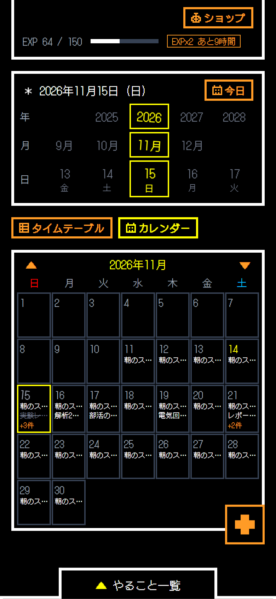
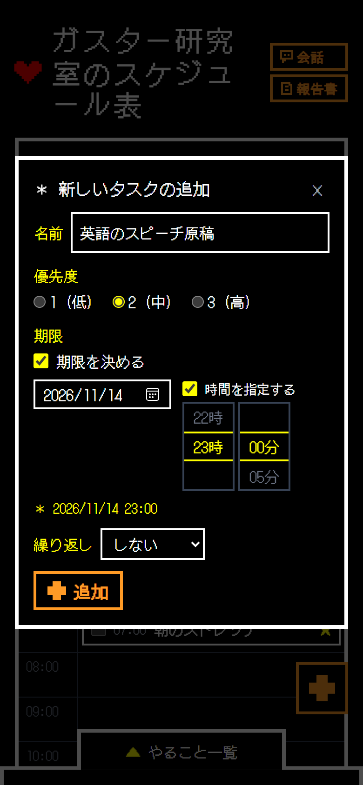
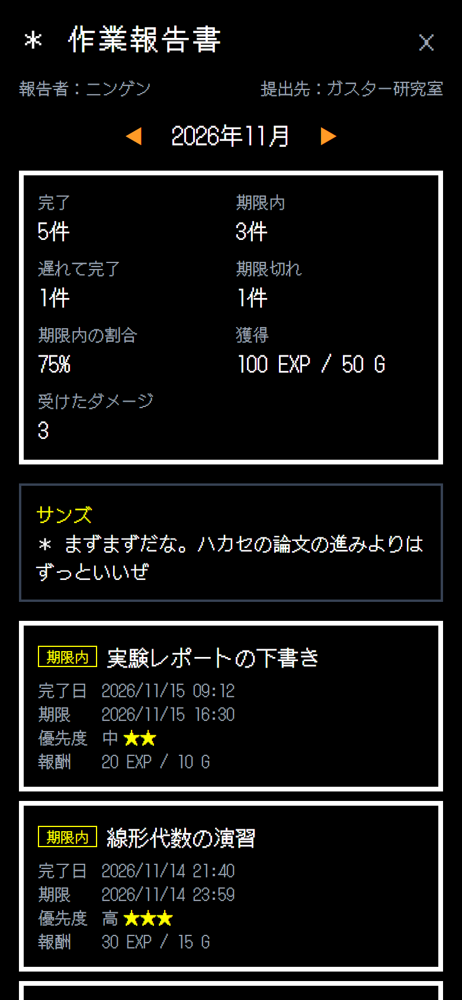
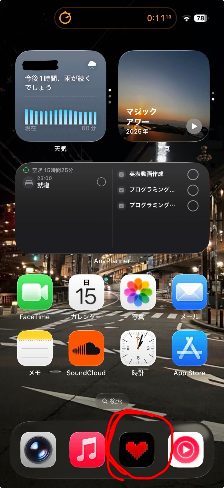
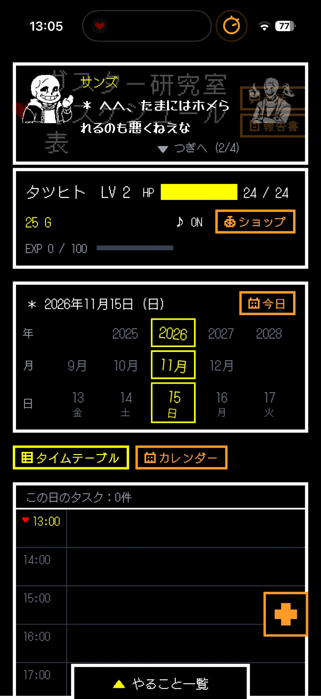

# ガスター研究室のスケジュール表

UNDERTALE（RPG）に出てくるサンズとガスター博士が、Todo の進み具合に合わせて掛け合いをしてくれる Todo アプリである。

公開ページ：https://tatsukodx.github.io/My_Todo_app/

## どんなアプリか

前提として、UNDERTALE 原作では、「ガスター博士」は既に故人で本編には登場せず、関連する手がかりもほとんどなく、素性が分からない、超シークレットなキャラだが、ファンの考察の中には「サンズとガスター博士は、かつて王国の研究所で一緒に働いていた」という説がある。

このアプリでは、ガスター博士とその助手サンズが、自分のタスク管理に付き合ってくれる。タスクを追加したとき、完了したとき、期限が過ぎたときなどに、上から会話ウィンドウが出てきて、二人がひとことずつ話す。

- サンズは、基本怠け者で、やる気がほとんどないが、ジョークを言いつつもガスター博士に振り回されている。ふだんは砕けた口調で、皮肉を言うときだけわざと敬語を使ったりもする。パピルスという弟がいる。
- ガスター博士は、ぶっ飛んだ発想のマッドサイエンティストに見えて、実は意外と常識人である。セリフは、原作に沿ってフォントWingdings 風の記号で表示されてから、日本語に変わる。

さらに、HP（自尊心）・LV・GOLD のゲーム要素を入れている。タスクをこなすと成長し、期限を破るとダメージを受ける。

## 着想・背景

- 自分はUNDERTALEというRPGが好きで、また、絵をかなり勉強していて得意なので、その二つを活かしたものを作りたいと思った。
- 考察や二次創作で見かける「研究所で働くサンズとガスター」の掛け合いを、自分の手で再現してみたいと思った。
- 普通の Todo アプリは、続かずに開かなくなってしまうことが多い。好きなキャラクターの会話や、ゲームのような報酬があれば、毎日開きたくなると考えた。

## スクリーンショット

| 会話のポップアップ | タイムテーブル | カレンダー |
| :---: | :---: | :---: |
|  |  |  |

| タスクの追加 | やること一覧 | ショップ | 作業報告書 |
| :---: | :---: | :---: | :---: |
|  |  |  |  |

## 主な機能

### タスク管理

- ステータスの下の項目で、年・月・日を横スワイプで選び、その日の24時間のタイムテーブルを表示する。
- タイムテーブルと月のカレンダーを切り替えられる。カレンダーの日を押すと、その日のタイムテーブルに移る。
- 右下の「＋」ボタンから、名前・優先度（1：低 〜 3：高）・期限を入れてタスクを追加する。
- 期限は、日付をカレンダーで選び、「時間を指定する」にチェックしたときだけ時・分をホイールで選ぶ。時間を指定しなければ、その日中が期限になる。
- 期限を決めなかったタスクは「とりあえず後でやる」に入り、あとから日時を決められる。これは、自分が使っていた「any planner」というTODOアプリからインスピレーションを受けた。
- 毎日・毎週・2週間ごと・毎月・○日ごとの繰り返しタスクを登録できる。
- 画面下の出っ張りを押すか上にスワイプすると、やること一覧が下から出てくる。

### 予定

- 習い事のように、時間が決まっていることは「予定」として登録できる。追加フォームで「タスク」と「予定」を切り替え、日付と、始まり・終わりの時刻を選ぶ。
- 予定も、毎週などの繰り返しにできる。毎週の習い事なら、一度登録すれば毎週の予定に入る。
- 予定は、終わったあと、その日のうちにチェックすると EXP と GOLD がもらえる。終わる前はチェックできない。
- チェックし忘れたまま日付が変わると、タスクの期限切れと同じようにダメージを受ける。
- タイムテーブルでは、始まる時刻の行にオレンジの枠で表示し、予定が続いている時間の行には「（つづき）」の印を付ける。

### サンズとガスター博士の会話

- タスクの追加・完了・全部完了・期限切れ・日時の決定・ダメージ・レベルアップなどの場面ごとに、会話を何パターンも作った。
- 会話は画面の上から出てきて、1文字ずつ表示され、自動で進む。
- 左にサンズ、右にガスター博士がいて、話している方の表情がセリフに合わせて変わる。

### ゲーム要素

- タスクを完了すると EXP と GOLD がもらえる。優先度が高いほど報酬が多くなる。
- 未完了のまま期限が過ぎると、HP（自尊心）にダメージを受ける。
- EXP がたまると LV が上がり、最大 HP が増える。HP が 0 になるとゲームオーバーである。
- ショップでは、GOLD で回復アイテムや、一時的に EXP・GOLD が2倍になるアイテムなどを買える。品数は23種類である。
- タスクの完了のチェックを何度も外したり付けたりすると、無限に経験値とGOLDが稼げてしまうのを防ぐため、一度チェックしたタスクは記憶しておき、報酬は一度だけもらえるようにした。

### 作業報告書

- 完了したタスクと期限切れになったタスクを記録し、月ごとの報告書として見られる。
- タスク名・完了日・期限・期限内にできたか・優先度・報酬を一覧にし、期限内に終えた割合などを集計する。

### 効果音と BGM

- メイン画面では「Gaster's theme」を、ピッチを50％に落としてゆっくり流す。曲の最初と最後はフェードイン・フェードアウトし、終わるとまた最初から流れる。
- ショップでは「sans.」をループで流す。画面を切り替えると、前の曲が小さくなってから次の曲に変わる。
- ガスター博士がしゃべっている間は、ガスター博士の声をくり返し流し、しゃべり終えると止める。サンズの声は、文字が1つ出るたびに鳴る。
- ボタンを押したとき、選択が動いたとき、タスクを完了したとき、LV が上がったとき、ダメージを受けたとき、回復したときに、それぞれ効果音が鳴る。ショップで買える２人のギャグを最後まで聞くと「ツクテーン」と鳴る。
- ステータス欄の「♪ ON / OFF」で、すべての音を消せる。ブラウザの決まりで、ページを開いて最初に画面を触ったときから音が鳴り始める。

## スマホで使う

スマホのブラウザでもそのまま使える。ホーム画面に追加すると、アプリのようにアイコンから開ける。ウェブアプリとして追加した場合は、Safari とは別の画面で開かれ、アドレスバーなども出ないので、普通のアプリと同じように使える。

| ホーム画面に追加したところ | アイコンから開いたところ |
| :---: | :---: |
|  |  |

### iPhone の場合

1. Safari で公開ページを開く。
2. 画面下の共有ボタン（四角から上向きの矢印が出ているボタン）を押す。
3. 「ホーム画面に追加」を選び、右上の「追加」を押す。

### Android の場合

1. Chrome で公開ページを開く。
2. 右上の「︙」メニューを押す。
3. 「ホーム画面に追加」を選び、「追加」を押す。

### スマホ向けにしたこと

- ホーム画面のアイコンは、黒の背景に赤いドット絵のハート（原作のソウル）にした。
- 年月日の選択、時・分のホイール、やること一覧の引き出しなどは、指でスワイプして操作できるようにした。
- 指で操作するときは、スクロールやタップのたびに選択の効果音が鳴ってうるさいので、スマホでは選択の効果音だけ鳴らさないようにした。
- ページを開くたびに「画面を押して はじめる」を出し、押してもらってから始めるようにした。スマホのブラウザは画面を触るまで音を鳴らさせてくれないため、こうすると最初のセリフから声が出る。

タスクやプレイヤーのデータは、開いた端末のブラウザの中に保存される。そのため、PC とスマホではデータが別々になる。

## こだわったところ

### UI

原作のバトル中の画面をイメージして作成した。原作のメッセージボックスのように白線で項目別に囲み、ボタンをコマンド選択ボタンのように、オレンジ色にした。選択された項目は、白から黄色に変わり、左側に主人公のソウル（赤いハート）を配置した。なるべく直感的に操作できるように、スクロールで操作できる部分をいろんな部分（日付操作、タイムテーブル、カレンダーなど）に実装した。

### 二人の口調とセリフ

セリフはAIにそれぞれのキャラの性格と設定を細かく教え込み、作らせたりした。しかし、小ネタや細かい口調までは模倣できなかったので、セリフを何度も直した。サンズは「ヘヘ、」、ガスター博士は「ふむ。」のような口癖を所々入れたり、敬語、ため口の切り替わるタイミングも難しかった。サンズは原作に沿って、漢字の一部をカタカナにしている。（本家は漢字は全部カタカナ）ガスター博士のセリフは、原作の Wingdings のように記号で表示してから、単語ごとに日本語へ変わるようにした。

### イラストと表情差分

会話の立ち絵とショップの絵は、すべて自分で描いた。原作はドット絵なので、サンズとガスターもドット絵で描いてみた。立ち絵は二人とも、普通・笑い・怒り・悲しみ・嘲笑・気まずいの表情差分がある。ショップの絵は、背景と二人の顔を別々の画像にして重ねている。セリフごとに表情を変えたり、サンズが片手をすくめる背景に切り替えたりしている。

### ゲーム要素とショップ

ただタスクにチェックを付けるだけでなく、達成すると成長し、サボるとダメージを受ける仕組みにした。ショップでは、アイテムを選んだとき・買ったとき・使ったときに、それぞれ二人が会話する。面白要素に「サンズのギャグ」と高級品の「ガスター博士のギャグ」も売っている。「パピルスのスパゲッティ」は回復量がランダムで、HP が減ることもある。「豆を挽きすぎたコーヒー」は、飲むと、多大なるカフェインの含有量のあまり、画面が揺れたり虹色に見えたりする。ごくまれに大当たり（5％）が出る。ぜひ買ってみてほしい。

### 音

原作の雰囲気に近づけるため、効果音と BGM を付けた。メイン画面のガスターのテーマは、ピッチを50％に落とすことで、研究所の不気味さを出した。やること一覧を閉じる音は、開く音の逆再生だが、別のファイルを用意せず、開く音の波形を前後反転させて作っている。

## 使用技術

- React 19 / TypeScript
- Vite
- Tailwind CSS 4
- Day.js（日付の計算）
- uuid、tailwind-merge、Font Awesome
- localStorage（タスク・プレイヤー・作業報告書・音の設定の保存）
- Web Audio API（BGM のピッチ変更とフェード、効果音の逆再生）
- GitHub Actions / GitHub Pages（公開）
- フォント：DotGothic16、Comic Neue、Mochiy Pop One（いずれも Google Fonts、SIL Open Font License）

サンズのセリフの日本語部分は、閲覧している PC に HGS創英角ﾎﾟｯﾌﾟ体（Microsoft Office に付属）が入っていれば、それで表示する。入っていない環境（スマホなど）では、雰囲気の近いポップ体の Mochiy Pop One で表示する。

## このアプリについて

このアプリは、UNDERTALE（Toby Fox）をもとにした非公式のファンメイド作品である。作中のキャラクターの権利は原作者に帰属する。イラストはすべて自作で、ゲームの画像・フォントは使っていない。効果音・キャラクターの声・BGM は原作のものを使っており（[Myinstants](https://www.myinstants.com) からダウンロード）、その権利は原作者に帰属する。

## 開発期間

開発期間：2026.11.8 ~ 2026.11.15（約20時間）
