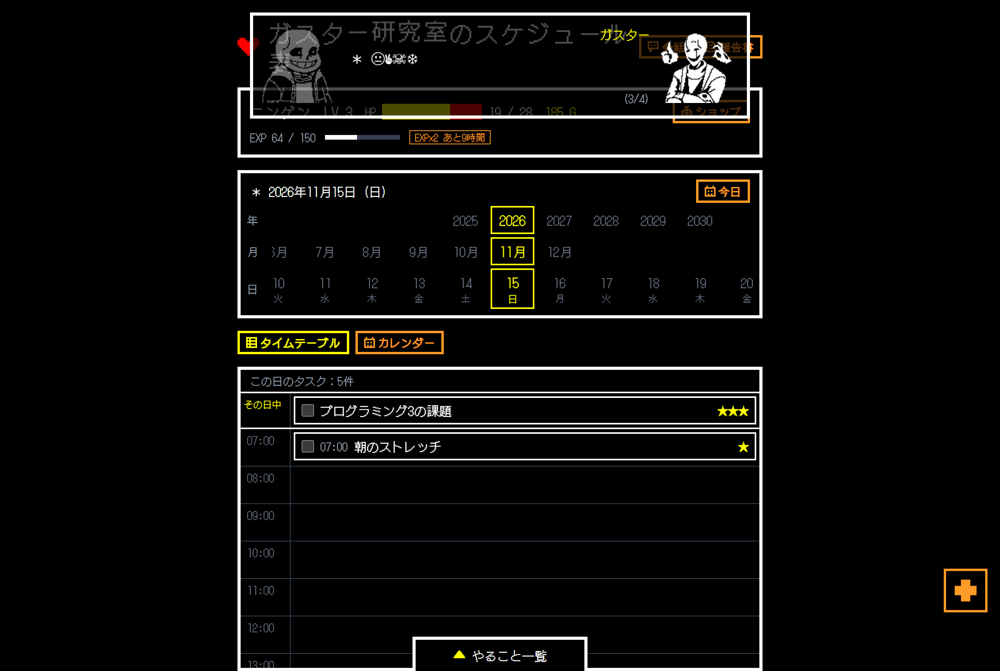
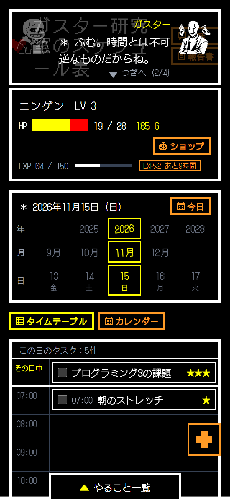
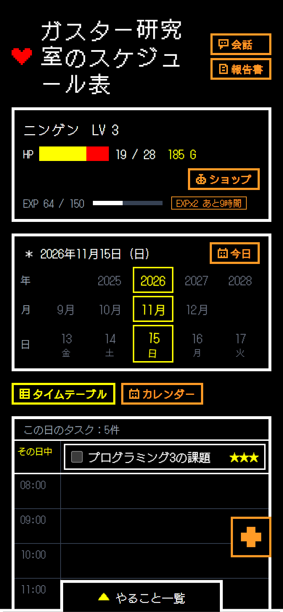
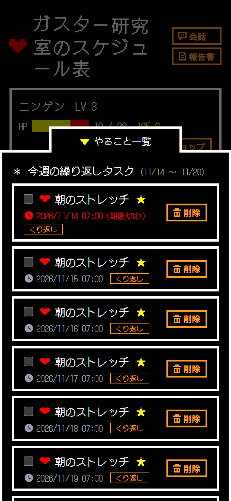
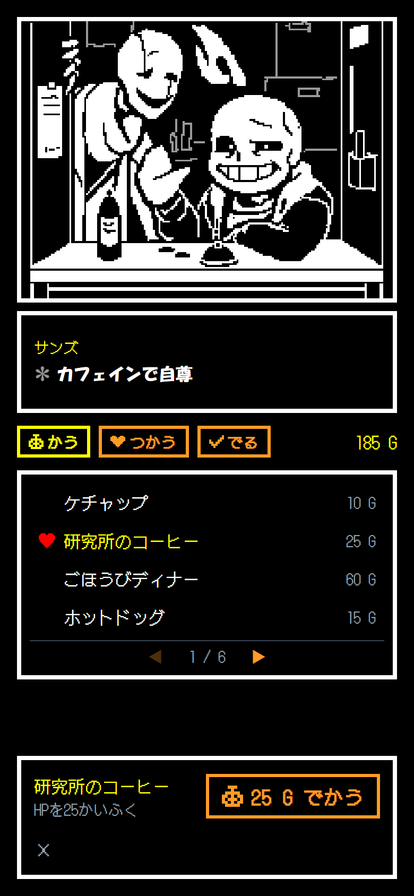

# ガスター研究室のスケジュール表

UNDERTALE のサンズとガスター博士が、Todo の進み具合に合わせて掛け合いをしてくれる Todo アプリです。

公開ページ：https://tatsukodx.github.io/My_Todo_app/

## どんなアプリか

UNDERTALE の考察の中には「サンズとガスター博士は、かつて王国の研究所で一緒に働いていた」という説があります。二次創作では、仕事に追われる二人の掛け合いがよく描かれています。

このアプリでは、その二人が研究所の同僚として、自分のタスク管理に付き合ってくれます。タスクを追加したとき、完了したとき、期限が過ぎたときなどに、上から会話ウィンドウが出てきて、二人がひとことずつ話します。

- サンズは、ジョークを言いつつも振り回される常識人です。ふだんは砕けた口調で、皮肉を言うときだけわざと「ですぜ」を使います。
- ガスター博士は、ぶっ飛んだ発想のマッドサイエンティストに見えて、実は常識人です。セリフは Wingdings 風の記号で表示されてから、日本語に変わります。

さらに、HP（自尊心）・LV・GOLD のゲーム要素を入れています。タスクをこなすと成長し、期限を破るとダメージを受けます。

## 着想・背景

- UNDERTALE が好きで、絵を描くのが得意なので、その二つを活かしたものを作りたいと思いました。
- 考察や二次創作で見かける「研究所で働くサンズとガスター」の掛け合いを、自分の手で動かしてみたいと思いました。
- 普通の Todo アプリは、続かずに開かなくなってしまうことが多いです。好きなキャラクターの会話や、ゲームのような報酬があれば、毎日開きたくなると考えました。

## スクリーンショット

| 会話のポップアップ | タイムテーブル | カレンダー |
| :---: | :---: | :---: |
|  |  |  |

| タスクの追加 | やること一覧 | ショップ | 作業報告書 |
| :---: | :---: | :---: | :---: |
|  |  |  |  |

## 主な機能

### タスク管理

- 年・月・日を横スワイプで選び、その日の24時間のタイムテーブルを表示します。
- タイムテーブルと月のカレンダーを切り替えられます。カレンダーの日を押すと、その日のタイムテーブルに移ります。
- 右下の「＋」ボタンから、名前・優先度（1：低 〜 3：高）・期限を入れてタスクを追加します。
- 期限は、日付をカレンダーで選び、「時間を指定する」にチェックしたときだけ時・分をホイールで選びます。時間を指定しなければ、その日中が期限になります。
- 期限を決めなかったタスクは「とりあえず後でやる」に入り、あとから日時を決められます。
- 毎日・毎週・2週間ごと・毎月・○日ごとの繰り返しタスクを登録できます。
- 画面下の出っ張りを押すか上にスワイプすると、やること一覧が下から出てきます。

### サンズとガスター博士の会話

- タスクの追加・完了・全部完了・期限切れ・日時の決定・ダメージ・レベルアップなどの場面ごとに、会話を何パターンも用意しています。
- 会話は画面の上から出てきて、1文字ずつ表示され、自動で進みます。
- 左にサンズ、右にガスター博士がいて、話している方の表情がセリフに合わせて変わります。

### ゲーム要素

- タスクを完了すると EXP と GOLD がもらえます。優先度が高いほど報酬が多くなります。
- 未完了のまま期限が過ぎると、HP（自尊心）にダメージを受けます。
- EXP がたまると LV が上がり、最大 HP が増えます。HP が 0 になるとゲームオーバーです。
- ショップでは、GOLD で回復アイテムや、一時的に EXP・GOLD が2倍になるアイテムなどを買えます。品数は22種類です。
- 「パピルスのスパゲッティ」は回復量がランダムで、HP が減ることもあります。「豆を挽きすぎたコーヒー」は、飲むと画面が揺れたり虹色に見えたりします。ごくまれに大当たりが出ます。

### 作業報告書

- 完了したタスクと期限切れになったタスクを記録し、月ごとの報告書として見られます。
- タスク名・完了日・期限・期限内にできたか・優先度・報酬を一覧にし、期限内に終えた割合などを集計します。

## こだわったところ

### 二人の口調とセリフ

二人の性格を決めてから、セリフを何度も直しました。サンズは「ヘヘ、」、ガスター博士は「ふむ。」のような相槌を入れ、サンズは漢字の一部をカタカナにしています。ガスター博士のセリフは、原作の Wingdings のように記号で表示してから、単語ごとに日本語へ変わるようにしました。

### イラストと表情差分

会話の立ち絵とショップの絵は、すべて自分で描きました。立ち絵は二人とも、普通・笑い・怒り・悲しみ・嘲笑・気まずいの表情差分があります。ショップの絵は、背景と二人の顔を別々の画像にして重ねています。セリフごとに表情を変えたり、サンズが片手をすくめる背景に切り替えたりしています。

### ゲーム要素とショップ

ただタスクにチェックを付けるだけでなく、達成すると成長し、サボるとダメージを受ける仕組みにしました。ショップでは、アイテムを選んだとき・買ったとき・使ったときに、それぞれ二人が会話します。「サンズのギャグ」と高級品の「ガスター博士のギャグ」も売っています。

## 使用技術

- React 19 / TypeScript
- Vite
- Tailwind CSS 4
- Day.js（日付の計算）
- uuid、tailwind-merge、Font Awesome
- localStorage（タスク・プレイヤー・作業報告書の保存）
- GitHub Actions / GitHub Pages（公開）
- フォント：DotGothic16、Comic Neue、Yusei Magic（いずれも Google Fonts、SIL Open Font License）

サンズのセリフの日本語部分は、閲覧している PC に HGS創英角ﾎﾟｯﾌﾟ体（Microsoft Office に付属）が入っていれば、それで表示します。入っていない環境では Yusei Magic で表示します。

## このアプリについて

このアプリは、UNDERTALE（Toby Fox）をもとにした非公式のファンメイド作品です。作中のキャラクターの権利は原作者に帰属します。イラストはすべて自作で、ゲームの画像・音楽・フォントは使っていません。

## 開発期間

開発期間：2026.10.16 ~ 2026.11.14（約20時間）
